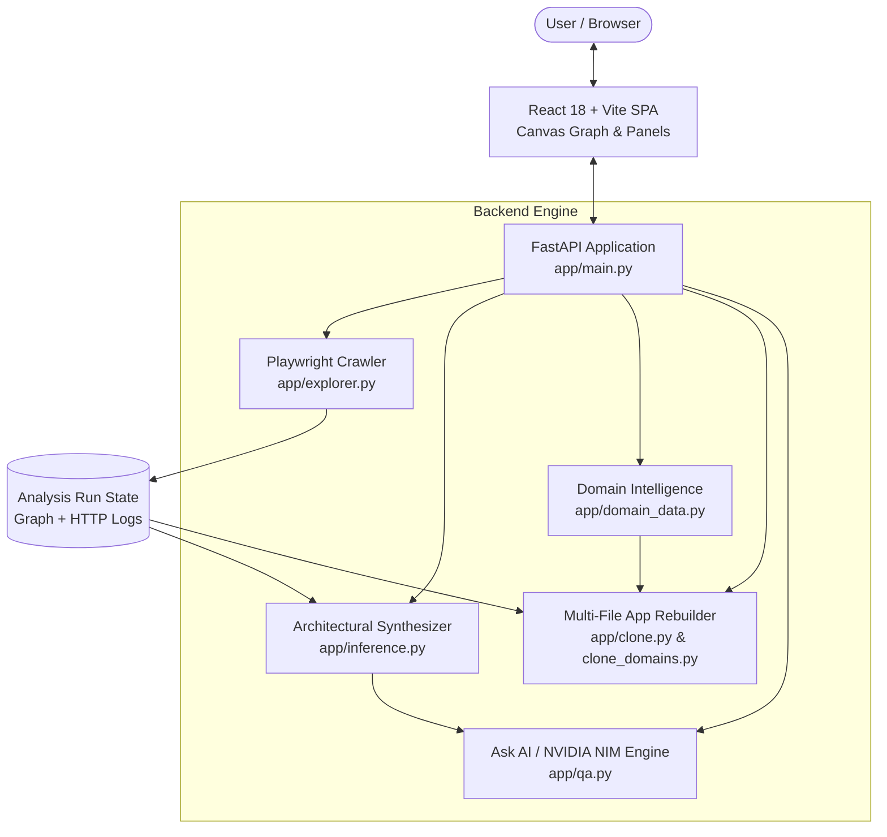

# Lumina (BlackBox Atlas)

> **Autonomous Behavioral Reverse-Engineering, Blueprint Synthesis, and Full-Stack Application Rebuilder**

Lumina (BlackBox Atlas) is an AI-powered system designed to map, understand, and automatically rebuild web applications from the outside in. By observing an application's runtime behavior through headless browser automation, Lumina generates interactive navigation flowcharts, infers architectural blueprints (data models, state machines, APIs, auth mechanics), links every conclusion to verified empirical evidence, and synthesizes runnable multi-file full-stack clones (React + FastAPI) with one click.

---

## Table of Contents

- [Key Features](#key-features)
- [System Architecture](#system-architecture)
- [Domain Intelligence](#domain-intelligence)
- [Ask AI (NVIDIA NIM Integration)](#ask-ai-nvidia-nim-integration)
- [Demo Mode vs. Target Exploration](#demo-mode-vs-target-exploration)
- [How to Run the Project](#how-to-run-the-project)
  - [Prerequisites](#prerequisites)
  - [First-Time Setup](#first-time-setup)
  - [Subsequent Runs (Quick Start)](#subsequent-runs-quick-start)
  - [Development Mode (Hot Reloading)](#development-mode-hot-reloading)
- [Interactive Workflows](#interactive-workflows)
- [API Reference](#api-reference)
- [Testing & Quality Assurance](#testing--quality-assurance)
- [Security & Safe Exploration](#security--safe-exploration)

---

## Key Features

1. **Autonomous Behavioral Cartography**
   - Headless Chromium crawler (powered by Playwright) that navigates links, buttons, forms, and dialogs.
   - Computes state hashes, identifies routing transitions, and deduplicates identical screens.
   - Interactive HTML5 Canvas graph rendering routes, interaction nodes, modals, and edge transitions.

2. **Architectural Blueprint Synthesis**
   - Automatically drafts technical hypotheses across 6 architectural dimensions: **Authentication & Session Management**, **API & Data Flow**, **State Management**, **Data Models**, **Component Hierarchy**, and **Security / Performance Boundaries**.
   - Identifies unknowns, blind spots, and generates targeted active verification experiments.

3. **100% Empirical Evidence Traceability**
   - Every architectural hypothesis cites exact HTTP request/response payloads, console events, and DOM elements captured during exploration.

4. **Multi-File Full-Stack Rebuild & Export**
   - Synthesizes a structured, runnable application featuring:
     - **Frontend**: React 18, TypeScript, Tailwind CSS, Lucide icons, responsive navigation, and stateful components.
     - **Backend**: FastAPI REST server with working endpoints, mock databases, and JSON schemas.
   - Exports complete projects as downloadable `.zip` archives or renders an isolated in-browser preview.
   - Legacy standalone single-file HTML clone option also available.

5. **Built-in Domain Intelligence**
   - High-fidelity pre-configured profiles for major consumer and enterprise applications (WhatsApp, Amazon, Spotify, YouTube, Twitter/X).
   - Generates realistic datasets, interactive media synthesizers (e.g., HTML5 Web Audio for music players), shopping cart state, and live messaging.

6. **Ask AI with NVIDIA NIM & Analytical RAG Fallback**
   - Deep architectural question answering powered by NVIDIA NIM (`meta/llama-3.1-70b-instruct`).
   - Built-in analytical Retrieval-Augmented Generation (RAG) fallback that computes answers offline directly from captured telemetry and blueprints if an API key is not present.

---

## System Architecture



### Core Code Structure

- [`backend/app/main.py`](file:///c:/Users/Asus/OneDrive/Desktop/Coding/VSCode-Insider/Lumina-main/backend/app/main.py): FastAPI application entrypoint, API routers, static single-page app serving, and demo fixture hosting.
- [`backend/app/explorer.py`](file:///c:/Users/Asus/OneDrive/Desktop/Coding/VSCode-Insider/Lumina-main/backend/app/explorer.py): Playwright-based crawler, state hashing, interaction discovery, and network request interception.
- [`backend/app/inference.py`](file:///c:/Users/Asus/OneDrive/Desktop/Coding/VSCode-Insider/Lumina-main/backend/app/inference.py): Hypotheses generator, architecture blueprint synthesizer, and evidence linking.
- [`backend/app/domain_data.py`](file:///c:/Users/Asus/OneDrive/Desktop/Coding/VSCode-Insider/Lumina-main/backend/app/domain_data.py): High-fidelity domain profiles, realistic mock stores, catalog data, and interactive feature specifications.
- [`backend/app/clone.py`](file:///c:/Users/Asus/OneDrive/Desktop/Coding/VSCode-Insider/Lumina-main/backend/app/clone.py): Multi-file runnable project generator, React component builder, standalone HTML bundler, and ZIP archiver.
- [`backend/app/clone_domains.py`](file:///c:/Users/Asus/OneDrive/Desktop/Coding/VSCode-Insider/Lumina-main/backend/app/clone_domains.py): Dedicated fullstack clone generators for WhatsApp Web, Amazon Storefront, and Spotify Web Player.
- [`backend/app/qa.py`](file:///c:/Users/Asus/OneDrive/Desktop/Coding/VSCode-Insider/Lumina-main/backend/app/qa.py): NVIDIA NIM API integration (`meta/llama-3.1-70b-instruct`) with automated offline heuristic RAG fallback.
- [`frontend/src/App.tsx`](file:///c:/Users/Asus/OneDrive/Desktop/Coding/VSCode-Insider/Lumina-main/frontend/src/App.tsx): Main dashboard managing analyses, live preview modals, and layout splitting.
- [`frontend/src/components/GraphView.tsx`](file:///c:/Users/Asus/OneDrive/Desktop/Coding/VSCode-Insider/Lumina-main/frontend/src/components/GraphView.tsx): Canvas-based interactive behavioral flowchart renderer.
- [`frontend/src/components/Insights.tsx`](file:///c:/Users/Asus/OneDrive/Desktop/Coding/VSCode-Insider/Lumina-main/frontend/src/components/Insights.tsx): Architecture hypotheses, evidence inspection, experiments, and Ask AI drawer.
- [`frontend/src/components/TargetForm.tsx`](file:///c:/Users/Asus/OneDrive/Desktop/Coding/VSCode-Insider/Lumina-main/frontend/src/components/TargetForm.tsx): Target URL configuration with automatic sample fixture loading in Demo mode.

---

## Domain Intelligence

When targeting well-known domains, Lumina synthesizes deep domain-accurate data, components, and APIs rather than generic placeholder boxes:

| Domain | Detected Patterns | Rebuilt Application Features |
| :--- | :--- | :--- |
| **WhatsApp Web** | `web.whatsapp.com`, `whatsapp.com` | Chat sidebar with active timestamps, searchable contacts, dynamic message input, QR code device pairing modal, profile settings, and FastAPI `/api/messages` & `/api/chats` endpoints. |
| **Amazon** | `amazon.com`, `amazon.*` | Product catalog with star ratings and Prime badges, department filters, reactive Add to Cart, slide-over cart drawer with pricing calculations, multi-step checkout, and mock order tracking. |
| **Spotify** | `spotify.com`, `open.spotify.com` | Music library with playlists and albums, now-playing bar, volume controls, and a working **Web Audio API synthesizer** generating harmonic chords on Play/Pause. |
| **YouTube** | `youtube.com` | Video feed, category chips, sidebar drawer, simulated video player view with comments. |
| **Twitter / X** | `twitter.com`, `x.com` | Tweet composer, feed timeline, metrics (likes/retweets), profile widgets, trending hashtags. |

---

## Ask AI (NVIDIA NIM Integration)

Lumina features an **Ask AI** natural-language inquiry bar inside the Architecture Insights panel:

1. **NVIDIA NIM Integration**: When configured with an API key, questions are dispatched to NVIDIA's cloud-hosted `meta/llama-3.1-70b-instruct` model via an OpenAI-compatible endpoint.
2. **Context-Enriched Prompting**: Queries are augmented with target domain intelligence, the complete behavioral graph topology, discovered API endpoints, state transition mechanics, and architecture blueprints.
3. **Smart Analytical RAG Fallback**: If no API key is set or the network is unreachable, an intelligent heuristic engine synthesizes structured answers directly from the captured graph, discovered state machines, and network logs.

### Setting Up NVIDIA API Key
You can obtain a free API key with complimentary credits at [NVIDIA NIM / Build](https://build.nvidia.com):
Add it to `.env`:
```env
NVIDIA_API_KEY=nvapi-your-key-here
```

---

## Demo Mode vs. Target Exploration

Lumina accommodates both safe offline demonstrations and external target analyses:

- **Demo Mode**:
  - Automatically loads the bundled synthetic multi-state target (`http://127.0.0.1:8000/demo`).
  - Pre-populates sample analysis fixtures in the UI with instant Rebuild/Preview capability.
  - Allows loopback crawling without security boundary blocks.
- **Non-Demo Mode**:
  - Tailored for analyzing live external websites entered in the Target URL bar.
  - Enforces SSRF defenses (blocks private subnets, loopback addresses, link-local metadata services).
  - Sample fixtures are disabled to ensure all insights represent fresh empirical crawls.

---

## How to Run the Project

### Prerequisites

Ensure you have the following installed on your machine:
- **Python 3.12+** (check with `python --version`)
- **Node.js 18+** & **npm** (check with `node --version` and `npm --version`)
- **Chromium browser binaries** for Playwright (installed via command below)

---

### First-Time Setup

#### Step 1: Open Terminal in the Project Root
```bash
cd c:\Users\Asus\OneDrive\Desktop\Coding\VSCode-Insider\Lumina-main
```

#### Step 2: Configure Environment Variables
Copy the sample environment file to `.env`:
```powershell
# Windows PowerShell:
Copy-Item .env.example .env

# Mac / Linux:
cp .env.example .env
```
*(Optional)* Open `.env` and add your `NVIDIA_API_KEY`:
```env
NVIDIA_API_KEY=nvapi-xxxxxxxxxxxxxxxxxxxxxxxxxxxxxxxx
```

#### Step 3: Set Up Python Backend Virtual Environment
```powershell
# Navigate into backend directory:
cd backend

# Create a virtual environment:
python -m venv .venv

# Activate the virtual environment:
# On Windows:
.venv\Scripts\activate
# On Mac/Linux:
# source .venv/bin/activate

# Install backend dependencies:
pip install -r requirements.txt

# Install Playwright browser binaries:
python -m playwright install chromium
```

#### Step 4: Install Frontend Dependencies and Build Assets
```powershell
# Navigate into frontend directory:
cd ..\frontend

# Install node dependencies:
npm install

# Build the production frontend bundle:
npm run build
```
The build artifacts will be emitted to `frontend/dist/`. FastAPI serves these files automatically.

---

### Subsequent Runs (Quick Start)

Once first-time setup is complete, you can start the entire application with a single command.

#### Option A: One-Click Startup Script (Recommended)

- **On Windows (PowerShell)**:
  ```powershell
  .\run.ps1
  ```
- **On Linux / macOS**:
  ```bash
  chmod +x run.sh
  ./run.sh
  ```

#### Option B: Manual Startup

```powershell
# 1. Activate the virtual environment:
cd backend
.venv\Scripts\activate

# 2. Run the FastAPI server:
uvicorn app.main:app --host 0.0.0.0 --port 8000
```

Open your browser and navigate to:
👉 **[http://localhost:8000](http://localhost:8000)**

---

### Development Mode (Hot Reloading)

If you are modifying both backend Python code and frontend React components simultaneously:

1. **Terminal 1 — Backend with Hot Reload**:
   ```powershell
   cd backend
   .venv\Scripts\activate
   uvicorn app.main:app --reload --port 8000
   ```
2. **Terminal 2 — Vite Dev Server**:
   ```powershell
   cd frontend
   npm run dev
   ```
   Open **[http://localhost:5173](http://localhost:5173)**. The Vite dev server will proxy API calls directly to `http://localhost:8000`.

---

## Interactive Workflows

### 1. Analyzing a Target Application
1. Open the Lumina dashboard at `http://localhost:8000`.
2. Enter the target URL in the header bar (e.g., `https://web.whatsapp.com` or `http://127.0.0.1:8000/demo`).
3. Set your exploration depth and max page limits.
4. Click **Start Exploration**.
5. Watch the real-time crawl feed as routes, network calls, and UI states are discovered.

### 2. Exploring the Behavioral Flowchart
- Navigate through discovered nodes on the interactive Canvas graph.
- Click any node to inspect route paths, state hashes, screenshots, and DOM summaries.
- Click any edge to review the trigger action (e.g., button click, form submission).

### 3. Reviewing Architecture Hypotheses & Evidence
- Click the **Insights** tab to review inferred technical blueprints.
- Expand any hypothesis (e.g., Auth mechanism, REST API structure) to see the exact captured HTTP payloads and DOM nodes supporting the inference.

### 4. Rebuilding & Exporting the Application
- In the top action bar or Insights drawer, click **Rebuild / Clone**.
- Choose between:
  - **Multi-File Runnable Project (Recommended)**: Produces an idiomatic React 18 + Tailwind frontend, a typed routing layer, modular components, and a dedicated FastAPI backend.
  - **Single-File Standalone HTML**: Produces an all-in-one portable HTML bundle with embedded styles and mock handlers.
- Click **Live Preview** to test the rebuilt app inside a secure, sandboxed iframe.
- Click **Download ZIP** to save the complete project repository ready to run locally with `npm run dev` and `uvicorn main:app`.

---

## API Reference

| Method | Endpoint | Description |
| :--- | :--- | :--- |
| `GET` | `/` | Serves the Lumina web dashboard (compiled SPA). |
| `GET` | `/demo` | Serves the local multi-page synthetic test application. |
| `POST` | `/api/analyses` | Starts a new exploration job for a given `target_url`. |
| `GET` | `/api/analyses/{id}` | Fetches status, graph nodes, edges, and blueprint hypotheses for a run. |
| `POST` | `/api/analyses/{id}/cancel` | Aborts an ongoing exploration run. |
| `POST` | `/api/clone-instant` | Generates a clone directly from a URL using domain intelligence. |
| `GET` | `/api/analyses/{id}/clone/preview` | Renders a sandboxed HTML preview of the rebuilt application. |
| `GET` | `/api/analyses/{id}/clone/zip` | Downloads a complete multi-file runnable project as a `.zip` archive. |
| `POST` | `/api/analyses/{id}/ask` | Dispatches architectural questions to NVIDIA NIM or RAG fallback. |
| `POST` | `/api/analyses/{id}/search` | Performs semantic and keyword search across all captured crawl evidence. |

---

## Testing & Quality Assurance

Lumina includes an extensive test suite covering crawlers, domain synthesizers, multi-file clone generation, and frontend components:

### Run Backend Tests (Pytest)
```powershell
cd backend
.venv\Scripts\activate
pytest
```
*Current suite: 63 passed unit tests.*

### Run Frontend Tests (Vitest)
```powershell
cd frontend
npm test
```
*Current suite: 10 passed test suites.*

---

## Security & Safe Exploration

- **Read-Only Exploration**: The crawler avoids executing destructive mutations (e.g. Delete buttons, logout triggers).
- **SSRF Hardening**: External crawl requests to loopback addresses (`127.0.0.1`, `localhost`), link-local IPs (`169.254.169.254`), and private RFC 1918 networks (`10.0.0.0/8`, `172.16.0.0/12`, `192.168.0.0/16`) are blocked by default.
- **Sandboxed Previews**: Generated clone previews are rendered inside strictly sandboxed iframe contexts.
- **Ethical Compliance**: Crawlers respect configured rate limits, depth boundaries, and timeout limits.

---

## License

This project is open-source and distributed under the terms of the **MIT License**.
